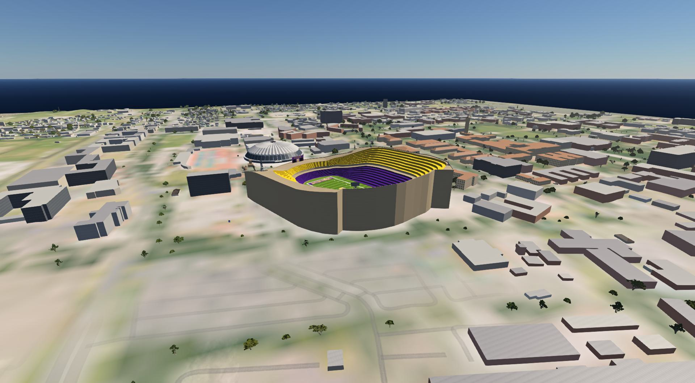
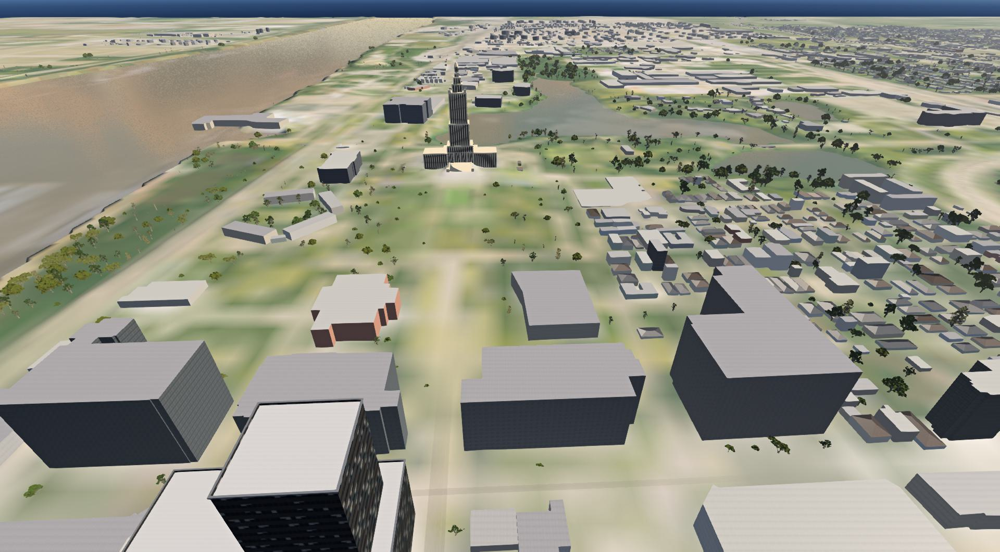

# Baton Rouge 1:1 for BeamNG.drive

`brmap` builds a 16 x 16 km, 1:1 scale BeamNG.drive map of Baton Rouge, Louisiana,
entirely from public data: USGS 3DEP lidar for the terrain, the building heights and the
trees, OpenStreetMap for roads, water and buildings, Microsoft building footprints for
the buildings OpenStreetMap lacks, USDA NAIP aerial photos draped on the ground (and
their near-infrared band to tell trees from roofs), and MRLC NLCD land cover for the
ground materials and the tree species. The landmarks and the swamp trees are modelled by
Blender scripts in this repo; the landmarks stand on their real footprints at their real
heights.




More in-game screenshots are in [docs/screenshots/](docs/screenshots/), version 0.2's in
[docs/screenshots/v02/](docs/screenshots/v02/).

What the finished map has (version 0.2, tested on BeamNG.drive 0.40.0):

* the real terrain on a 4 m grid (from 1 m lidar), with the aerial photo on top
* about 24,000 OpenStreetMap roads as decal roads, from interstates to driveways
* 252 bridge decks as solid mesh roads: the I-10 Mississippi River bridge (Horace
  Wilkinson Bridge), the elevated I-110 and I-10, interchange ramps and overpasses, with
  concrete Jersey barriers on all of them (the two 6 m ramp stubs get only a short piece)
  and piers under the 116 decks that stand 2.5 m or more over the ground or the river
  bed. The Horace Wilkinson Bridge has its steel cantilever truss and its river piers
* modelled landmarks, each with levels of detail and a collision mesh: Tiger Stadium
  (both decks, the field with original graphics and end zones reading "BATON ROUGE", the
  scoreboard and the light towers), the Memorial Tower with its four clocks, the Pete
  Maravich Assembly Center (PMAC), Alex Box Stadium, Mike the Tiger's habitat, the
  Louisiana State Capitol (137 m to the top of its lantern) and the Old State Capitol
* the LSU campus core (22 buildings around the Quad) in tan stucco with red tile roofs,
  and six downtown standouts (One American Place, the towers at 451 Florida and on North
  Laurel, the Heidelberg Hotel, the River Center arena and library) with window-grid
  facades
* the Mississippi River, the LSU lakes, City Park Lake, Capitol Lake and about 90 other
  water bodies, carved into the terrain, and 301 bayous, creeks, canals and drains
  (122 km) as murky still water in the channels the lidar shows, with 7 swamp pools
* 72,807 buildings (11,446 from OpenStreetMap, 61,361 Microsoft building footprints) at
  heights measured from 2 m lidar surface data. Towers that rise from a wider base are
  separate, taller parts with clean right-angled outlines, small houses have hipped
  roofs, and the walls go by type: siding on houses, brick, concrete, and glass over
  20 m (tall civic buildings stay concrete)
* 168,072 trees standing on the tree tops the lidar finds: bald cypress (23,212) and
  water tupelo (15,871) modelled for this map in the wetlands and along the bayous,
  Spanish moss on 14,651 live oaks and 6,994 of the cypress, and BeamNG's own stock tree
  models as stand-ins for the live oaks, water oaks, pines and a few palms
* 11,389 painted markings on motorway to tertiary roads, bridge decks included: dashed
  lane lines, double yellow center lines, the edges of center turn lanes, white and
  yellow edge lines, 1,080 stop bars at signals and stop signs, and 346 crosswalks
* AI traffic: the game's own traffic drives the streets, the interstates and the
  bridges, with lane counts and speed limits from OpenStreetMap
* three spawn points: the LSU Tiger Stadium lot, the State Capitol, and the top of the
  I-10 Mississippi River bridge

Its limits, and what it does not have yet (traffic lights, signs, street lights), are
in [docs/known-issues.md](docs/known-issues.md).

## Quick start (Windows)

```
python -m venv .venv
.venv\Scripts\pip install -e .
.venv\Scripts\python -m brmap all
```

The first run downloads about 2.1 GB into `data/raw`: lidar 1.1 GB, aerial photos
0.5 GB, the Louisiana OpenStreetMap extract and land cover, and for the buildings and
trees the 3DEP lidar surface tiles (about 245 MB), the NAIP red and near-infrared bands
(about 95 MB) and the Microsoft footprints (about 44 MB), and the CC0 texture sets a
material binds (today only `turf`, from ambientCG, about 5 MB; the other five stay in
`textures.yaml` with their provenance but are not fetched). That can take an hour or
so, depending on the servers. Later runs reuse
that cache, and the build itself takes about seven minutes once Blender has built the
models (on the first run, and again only for a model whose script, parameters or
Blender version changed). The result is `dist/baton_rouge.zip`; a release adds the
compiled meshes and the tree imposters (see [Shipping the compiled meshes and
imposters](#shipping-the-compiled-meshes-and-imposters)), which makes it about 242 MB.

It needs Python 3.12 or newer (built with 3.12.10) and Blender 5.2, which the `models`
stage runs headless to build the landmarks and the swamp trees: set its path as
`blender.exe` in `config.yaml` (`C:/Desktop/blender.exe` by default). `pip install -e .`
installs the Python dependencies too; use `pip install -e .[dev]` to add pytest for the
tests.

## Playing it

* **On your PC:** copy `dist/baton_rouge.zip` into
  `%LOCALAPPDATA%\BeamNG\BeamNG.drive\current\mods\`, start the game, open Freeroam and
  pick **Baton Rouge 1:1**. To go straight to the map:
  `"C:\Program Files (x86)\Steam\steam.exe" -applaunch 284160 -level baton_rouge`.
  The map is tested on BeamNG.drive 0.40.0.
* **AI traffic:** switch traffic on in Freeroam's options. The cars use the game's own
  traffic system and drive over the bridges too.
* **On GeForce NOW:** GeForce NOW only loads mods from the official BeamNG repository,
  so the map has to be uploaded there and approved first. The steps and the text to
  paste are in [docs/repo-submission.md](docs/repo-submission.md).

## Stages

`python -m brmap <stage> [--config config.yaml]` runs one stage; `all` runs them in order:

| Stage | What it does | Writes |
|---|---|---|
| `fetch` | downloads and caches the source data (retries, skips what is cached) | `data/raw/` |
| `terrain` | merges the lidar tiles into a 4096 x 4096 height grid, fills gaps, carves water | `data/out/heights*.npy`, `heightmap.png` |
| `water` | water polygons from OpenStreetMap with a surface level from the lidar | `data/out/water.json` |
| `imagery` | aerial photo mosaic and the five ground material layers | `data/out/basecolor.png`, `layers.npy` |
| `roads` | OpenStreetMap roads clipped to the box, bridges merged and given deck heights | `data/out/roads.json` |
| `features` | building footprints, tree and signal nodes, waterways, wetlands and landmark areas from OpenStreetMap; Microsoft footprints; lidar surface heights; NAIP near-infrared (downloads what is not cached) | `data/raw/osm_features.json`, `ms_buildings.json`, `dsm/`, `naip_rn_2m.tif` |
| `canopy` | a 2 m grid of height above ground and vegetation index | `data/out/ndsm.npy`, `ndvi.npy`, `canopy.json` |
| `textures` | the CC0 textures from ambientCG and Poly Haven that a material binds (today only `turf`; downloaded once into `data/raw/textures/`, each file checked against its recorded sha256; the other sets stay in `textures.yaml` and are not fetched) and the textures the repo draws itself, as DDS; every texture is listed in `docs/textures.md` | `data/out/textures/` |
| `landmarks` | the landmarks of `src/brmap/data/landmarks.yaml` (Tiger Stadium, the Memorial Tower, the PMAC, Alex Box Stadium, Mike the Tiger's habitat, the State Capitol, the Old State Capitol and the Horace Wilkinson Bridge's truss) on their OpenStreetMap footprints, set on the terrain and turned to their real heading, with what their models need from the lidar (the stadium's rim) and from the decks (the truss); every height and size has a cited source | `data/out/landmarks.json` |
| `models` | runs the Blender scripts of the landmarks and the custom trees headlessly (`blender.exe` in the config) and keeps their meshes as npz files; a model is rebuilt only when its script, `blender/lib/`, its params or Blender change; skipped where there is nothing to build | `data/out/models/<name>/` |
| `bayous` | bayous, creeks, canals and drains from OpenStreetMap as murky River objects in the channels the lidar shows (cut at roads and lakes, the terrain left uncarved), and swamps and marshes as standing water below the roads and clear of the other water | `data/out/bayous.json` |
| `buildings` | footprints with heights, roofs and wall types, off the roads and water; the buildings a landmark replaces left out; the LSU campus core and six downtown standouts (`src/brmap/data/styled.yaml`) set apart for their own styles (tan stucco and red tile on the campus, facades with window grids downtown) | `data/out/buildings.json`, `styled.json` |
| `trees` | tree positions, species and sizes from the canopy grid, clear of roads, buildings, water and landmarks; bald cypress and water tupelo in the wetlands and along the bayous, Spanish moss on a share of the live oaks (`trees.moss_share`) | `data/out/trees.json` |
| `markings` | lane lines, stop bars and crosswalks on motorway to tertiary roads | `data/out/markings.json` |
| `dressing` | concrete Jersey barriers along the edges of the bridge decks (on across a straight joint between two deck pieces, and stopping 2 m short of a deck's end on the ground and where a ramp merges or leaves), and piers under the decks where they stand 2.5 m or more over the ground or the river bed, off the roads beneath | `data/out/dressing.json` |
| `level` | the BeamNG level folder, the level's licence plate design and the mod zip, with the compiled meshes and imposters from `data/out/cdae/` where they still match | `dist/level/`, `dist/baton_rouge.zip` |
| `validate` | sanity checks and overlay images for a visual check | `data/out/problems.txt`, `overlay*.png` |

`all` runs `terrain` twice (before and after `water`) because the water levels come
from the uncarved terrain and the carving needs the water. Logs go to `data/logs/`.
The `level` stage adds the buildings, the styled buildings, the trees, the markings, the
landmarks, the bayous and the deck dressing only when their `data/out/*.json` exists.
The mod zip holds two folders: `levels/baton_rouge/`, the level, and
`vehicles/common/licenseplates/baton_rouge/`, its licence plate design (plain plates with
three digits and three letters; BeamNG.drive 0.40 looks for one for each level).

## Shipping the compiled meshes and imposters

BeamNG compiles every COLLADA mesh (`.dae`) into its own binary form (`.cdae`) the first
time a level loads, and builds imposters (the flat pictures it draws a tree as far away)
for the tree models that ask for them. For the map's 3,272 shapes (3,006 building tiles,
plus the landmarks, the styled buildings, the deck dressing and the custom trees) that is
most of a first load, and a GeForce NOW session starts fresh every time, so it would
happen on every visit. A release therefore ships each shape's `.cdae` beside its `.dae`,
as the stock maps do, and each tree's imposters (`<shape>.dae.imposter.dds` and
`.imposter_normals.dds`) with them. The game is the only compiler, so this is a release
step after the build:

1. Build: `.venv\Scripts\python -m brmap all`.
2. Copy `dist/baton_rouge.zip` into the mods folder and load the map once in the game.
   The game compiles the meshes and builds the imposters into the user folder's
   `temp\levels\baton_rouge`.
3. Run `.venv\Scripts\python tools\ingame\collect_meshes.py`. It copies the compiled
   meshes and the imposters made from this build into `data/out/cdae/`, and warns for each
   tree it has no imposters for. A release needs a run with no warnings.
4. Run `.venv\Scripts\python -m brmap level` again. A release needs its log to show
   `imposters: N pairs shipped, 0 withheld` and, on the compiled meshes line, `0 left for the
   game to compile`; if it does not, repeat steps 2 to 4.

The `level` stage reuses a compiled mesh only while its `.dae` is byte for byte the one it
was made from, and a tree's imposters only while the tree also looks as it did then: its
`.dae.asset.json`, the entries of the materials its `.dae` binds and the bytes of the
textures they name that ship in the level (`data/out/cdae/imposters.json` records a
fingerprint of them). The fingerprint leaves things out: a stock texture (`/assets/...`)
is hashed by its path only, and the game version is not part of it. A game update that
changes how imposters are drawn is therefore caught only by the game's own rule, which
renders an imposter again when the shape file is newer than it, and a shipped imposter is
always the newer file, so it is not caught at all. Collect the imposters again after a
game update (delete `data/out/cdae/imposters.json`, run `.venv\Scripts\python -m brmap level`
so that the zip you load ships no imposters, then follow steps 2 to 4). The `level` stage
logs how many it shipped:
`imposters: 3 pairs shipped, 0 withheld` and `compiled meshes: 3272 shipped, 0 left for the
game to compile`. Any shape it could not ship is compiled by the game as before, and
withheld imposters are rendered at load (steps 2 and 3 collect them again). On the test
laptop a cold first load of version 0.1 took 98 s with the compiled meshes, against 165 s
without them. The release zip of version 0.2, with all 3,272 compiled shapes and the imposters,
loaded cold in 65 s on BeamNG.drive 0.40.0 (5.0 GB of memory at the peak).

## Configuration

`config.yaml` holds everything you might change: the map center and size, the terrain
grid size and height range, bridge clearance and per-bridge deck heights, the level
name and title, the spawn points (by latitude and longitude) and the data sources. The
`buildings`, `trees`, `markings` and `traffic` sections switch the Microsoft footprints,
lane markings and AI traffic on or off, and set the building tile size and the tree cap.
`blender.exe` is the Blender that builds the models and `textures.max_size` the longest
side of a converted texture; `landmarks.enabled`, `bayous.enabled`, `trees.swamp` (the
cypress and tupelo) and `bridges.dressing` (the deck barriers and piers) switch the
version 0.2 features on or off, `trees.moss_share` sets the share of live oaks that carry
moss, and the rest of the `bayous` section picks the OpenStreetMap waterway kinds, the
shortest one kept and the node spacing.

`config.lsu.yaml` builds a 3 km test map around LSU (`baton_rouge_lsu`, about 20 MB, with
Tiger Stadium, the Memorial Tower, the PMAC, Alex Box Stadium, Mike the Tiger's habitat
and the campus core; the downtown landmarks lie outside it) into `data/out_lsu` and
`dist/lsu`, sharing the downloaded data. It is the quick way to check a landmark in the
game:

```
for %s in (terrain water terrain imagery roads features canopy textures landmarks models bayous buildings trees markings dressing level validate) do .venv\Scripts\python -m brmap %s --config config.lsu.yaml
```

`config.debug.yaml` builds a 3 km test map around the center (`baton_rouge_debug`,
about 10 MB) into `data/out_debug` and `dist/debug` the same way, with
`--config config.debug.yaml`. Each map has its own level name, so all three can sit in
the mods folder at once.

## Checking the result

* `data/out/overlay.png` shows the whole map: hillshade blended with the aerial photo,
  roads at their real width (bridges in red), water outlines in blue, building
  footprints in grey, trees as small green dots, spawns in yellow.
  `overlay_<spawn>.png` zooms in on each spawn point.
* `data/out/problems.txt` lists anything the validator did not like ("no problems
  found" when clean). Besides the roads and decks it checks, once those stages have run,
  that no building stands on a road or a deck and no tree on one or in a building, that
  buildings and trees sit on the terrain, that no drivable road crosses a landmark or
  reaches into its footprint, that the cut which keeps a landmark off the lanes beside it
  took no more than 2 % of its footprint and neither split it nor left a hole, that each
  landmark stands on the terrain, that the deck barriers and piers keep off the other
  roads, that the paint and the bayous stay inside the box, and that no shape in the
  built level passes 60,000 vertices in a level of detail.
* `python -m pytest tests -q` runs the unit tests. `tests/test_game_assets.py` also
  checks the textures, tree shapes, river and licence plate files the level borrows from
  the game; it runs only when BeamNG.drive is installed (set `BEAMNG_GAME_DIR` if it is
  not in Steam's default library). The tests that need Blender skip without it.
* `tools/ingame/` has two in-game checks, run from the game's user folder
  (`%LOCALAPPDATA%\BeamNG\BeamNG.drive\current`): copy the `.lua` files into its
  `lua\ge\extensions\` folder (an unpacked mod is mounted too late for
  `-onLevelLoad_ext`) and delete them again afterwards.
  * `brmapTest.lua`: start the game with `-level baton_rouge -onLevelLoad_ext brmapTest`
    (or `-level baton_rouge_lsu` or `-level baton_rouge_debug` for the 3 km maps). The
    extension logs object counts (buildings and landmarks are `TSStatic`, the trees one
    `Forest`) and terrain heights to `beamng.log` (tag `brmapTest`),
    then flies the camera through a few views: the bridges, downtown and its towers, the
    Capitol, the trees on the LSU Quad and the paint on Government Street, then the
    Memorial Tower, both State Capitols, the truss, the piers, the swamps and the moss (the
    LSU map has its own views of the LSU landmarks, the campus core and the bayous). Eight
    seconds into each view the game saves a
    screenshot to `screenshots\brmap\<level>_<view>.jpg` in the user folder; these come
    from the engine, so other windows on the desktop can't spoil them.
  * After the views it checks the traffic: it spawns 6 AI cars by the player's car,
    lets them drive for 60 seconds (with respawning off) and logs each car's distance
    from where it spawned and its speed, then `traffic moved N/M over 100 m`. Every car
    should get past 100 m; on the full map all 6 drove 400 to 780 m. It removes the cars
    again and logs `done`.
  * `capture_views.ps1` is optional: run it alongside and it saves a full-screen capture
    of each view as well (`-OutDir` picks the folder); `crop_screenshots.py` trims the
    window title bar off those.
  * `brmapDrive.lua` test-drives the map. `drive_routes.py` writes the routes (I-10 both
    ways over the split and the river bridge, the I-110 north of the split, two streets
    by the LSU lakes) to `dist/brmap_routes.json`; copy that file into the user folder,
    then start the game with `-level baton_rouge -onLevelLoad_ext brmapDrive`. It steers
    the car along each route, parks it at two far corners, and logs the car's height
    against the deck to `temp\brmapDrive_log.txt`; `capture_drive.ps1` saves a screen
    capture every 20 seconds meanwhile.
  * `measure_load.ps1 -Level <name>` starts the game with `brmapTest` and appends the
    load time (until brmapTest's first status line) and the peak memory of the game to
    `data/logs/loads.csv`.
  * `collect_meshes.py` is not a check: it collects the meshes the game compiled and the
    imposters it built, for a release (see [Shipping the compiled meshes and
    imposters](#shipping-the-compiled-meshes-and-imposters)).

## How it works, briefly

* **Coordinates:** level meters are UTM zone 15N (NAD83) relative to the map center,
  x east and y north. The grids are north-up; the terrain file stores the south row
  first, which the in-game check confirmed (heights match to 1 mm).
* **Terrain:** every lidar project covering a tile is used, newest first, so a partial
  new survey is completed by an older one. Water bodies are carved below their surface
  level (the Mississippi 15 m deep).
* **Roads:** widths come from OpenStreetMap lane counts (3.6 m interstate lanes, 3.3 m
  arterials, 3.0 m streets) plus shoulders. Interstates use a concrete texture,
  arterials asphalt, streets an older worn asphalt.
* **Bridges:** OpenStreetMap bridge pieces that meet are joined end to end whatever
  their names or layers, and a ramp starts at the height of the deck it leaves and
  stays level with it until the two part. Each deck then gets the lowest smooth profile
  that stays above the ground and clears the roads and lower decks crossing under it by
  5.5 m, climbing at 5 % where it can and at most 8 % from its ends. The Mississippi
  River bridge's crest is set 52 m above the ground at its ends (`bridges.overrides` in
  `config.yaml`). Where the ground would still poke through a deck, the level cuts the
  terrain just under it. Barriers run along the deck edges and on across a joint where
  one deck piece carries on from the next at its level, within 30 degrees of straight on
  (a wider piece's barriers taper in to the narrower one's line); they stop 2 m short of
  a deck's end on the ground, where a ramp merges or leaves, and where two decks meet at
  a sharper angle. Piers stand every 30 m where a deck is 2.5 m or more over the ground
  or the river bed, in the game's own concrete.
* **Buildings:** Microsoft footprints are added where they overlap OpenStreetMap ones by
  less than 30 % of their area, and footprints that would stand on a road, a deck or
  water are left out. A building's height comes from the lidar surface over its roof
  (for about 95 % of them), or else from its OpenStreetMap tags, Microsoft's height or a
  default for its type. A tower part traced from the lidar's 2 m cells gets a clean
  right-angled outline instead of the cells' stair steps. The 2 m lidar clips thin tops,
  so the State Capitol and the Memorial Tower are models at their published heights
  (137 m and 53 m). The buildings are meshes in 256 m tiles, each with a simpler distant
  version and a collision mesh, placed as one `TSStatic` per tile.
* **Landmarks:** each is a Blender script in `blender/landmarks/` (shared helpers in
  `blender/lib/`), run headless by the `models` stage; `brmap.collada` turns the meshes
  into `.dae` files. A landmark stands on its OpenStreetMap footprint at the lowest
  terrain along its outline, replaces the generic buildings and trees there, and no
  drivable road crosses it: its footprint is cut back to keep 0.5 m off the lanes of the
  roads beside it (Tiger Stadium's east wall steps in by up to 1.9 m along Powerhouse
  Lane). Its heights and sizes are in `src/brmap/data/landmarks.yaml`,
  each with its source. Its textures are the game's own, CC0 downloads or drawn by the
  repo (`docs/textures.md`); the field graphics and the scoreboard are original, with no
  real logo, wordmark or trademark anywhere.
* **Trees:** the canopy is where the lidar surface is 4 m or more above the ground and
  the near-infrared aerial photo shows vegetation; a tree stands on each of its local
  high points, away from roads, buildings, water and landmarks, scaled to the measured
  height. The land cover picks the species: live oaks (the stock west coast oak, cork
  oak, holm oak and east coast oak), water oaks, a stand-in for loblolly pine and a few
  palms; in the woody wetlands and along the bayous, bald cypress and water tupelo
  modelled for this map (buttressed and swollen trunks, cypress knees, some cypress hung
  with moss). About 30 % of the live oaks in developed areas carry Spanish moss
  (`trees.moss_share`). Trees whose collision reaches into a road below 3 m are left out.
* **Bayous:** each OpenStreetMap waterway follows the channel the lidar shows, with its
  surface a little above the channel's bottom; the terrain is not carved for it, and it
  stops short of the roads it passes under. Swamps and marshes become standing water that
  fills their low spots, kept below the roads and clear of the lakes' and rivers' own
  water.
* **Markings:** the paint stops at junctions, stop bars go on the approaches to
  OpenStreetMap traffic signals and stop signs, and crosswalks on its marked crossings.
  On bridges the paint lies on the deck.
* **Traffic:** each bridge deck has an invisible AI road laid over it, so the game's AI
  road network runs across the bridges. Every road carries its lane count and its
  OpenStreetMap speed limit (or a default by road class). Drives that OpenStreetMap maps
  under buildings (`tunnel=building_passage`, `covered=yes`) are drawn but left out of
  the AI road network, because the buildings are solid.

## Credits

Map data © OpenStreetMap contributors (ODbL). Building footprints © Microsoft (ODbL).
Elevation and surface: USGS 3DEP. Imagery: USDA NAIP. Land cover: MRLC NLCD.
Textures: ambientCG and Poly Haven (CC0).

The road, terrain and ordinary building textures are BeamNG's own shared assets and the
stock tree models come from the stock maps; all of them are referenced from the game and
not copied into the mod (the mod carries only the stock tree models' material
definitions), as are the licence plate's background and normal map. The landmarks, the
styled buildings, the deck dressing, the cypress, the tupelo and the moss are this repo's
own models; their textures are the game's, the CC0 downloads, or drawn by the repo's
scripts, and every logo on them is original. OpenStreetMap data and Microsoft's building
footprints are under the Open Database License, which requires the attribution above
wherever the map is shared. Because the map merges the two, the license also asks for the
merged data, or the method used to make it, to be offered with the map; see
[docs/repo-submission.md](docs/repo-submission.md). The US government data (USGS, USDA,
MRLC) is in the public domain. The textures from ambientCG and Poly Haven are CC0 (public
domain); [docs/textures.md](docs/textures.md) lists every texture with its source, licence
and, for the downloads, the recorded sha256.
