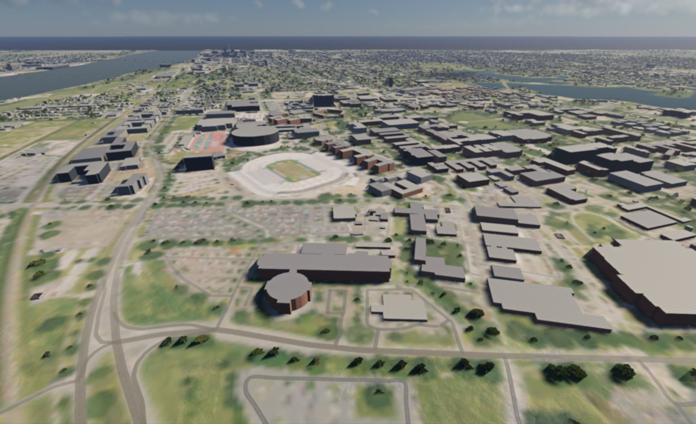
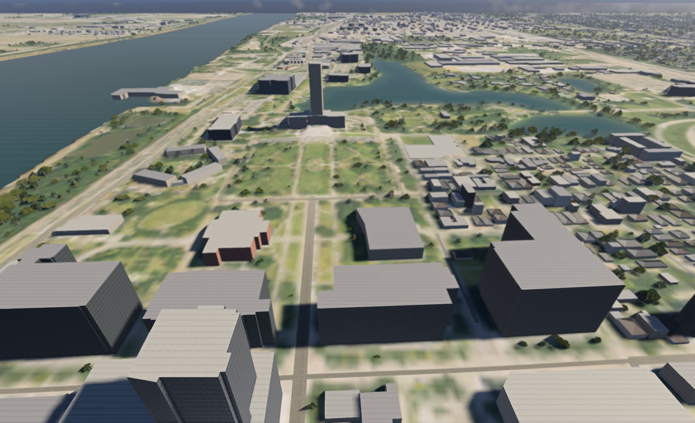

# Baton Rouge 1:1 for BeamNG.drive

`brmap` builds a 16 x 16 km, 1:1 scale BeamNG.drive map of Baton Rouge, Louisiana,
entirely from public data: USGS 3DEP lidar for the terrain, the building heights and the
trees, OpenStreetMap for roads, water and buildings, Microsoft building footprints for
the buildings OpenStreetMap lacks, USDA NAIP aerial photos draped on the ground (and
their near-infrared band to tell trees from roofs), and MRLC NLCD land cover for the
ground materials and the tree species.




More in-game screenshots are in [docs/screenshots/](docs/screenshots/).

What the finished map has:

* the real terrain on a 4 m grid (from 1 m lidar), with the aerial photo on top
* about 24,000 OpenStreetMap roads as decal roads, from interstates to driveways
* 252 bridge decks as solid mesh roads: the I-10 Mississippi River bridge (Horace
  Wilkinson Bridge), the elevated I-110 and I-10, interchange ramps and overpasses
* the Mississippi River, the LSU lakes, City Park Lake, Capitol Lake and about 90 other
  water bodies, carved into the terrain
* 72,816 buildings (11,454 from OpenStreetMap, 61,362 Microsoft building footprints) at
  heights measured from 2 m lidar surface data. Towers that rise from a wider base are
  separate, taller parts (the State Capitol's tower reaches about 114 m), small houses
  have hipped roofs, and the walls go by type: siding on houses, brick, concrete, and
  glass over 20 m (tall civic buildings stay concrete)
* 166,138 trees standing on the tree tops the lidar finds, using BeamNG's own stock tree
  models as stand-ins for live oaks, water oaks, pines, swamp cypress and a few palms
* 11,389 painted markings on motorway to tertiary roads, bridge decks included: dashed
  lane lines, double yellow center lines, the edges of center turn lanes, white and
  yellow edge lines, 1,080 stop bars at signals and stop signs, and 346 crosswalks
* AI traffic: the game's own traffic drives the streets, the interstates and the
  bridges, with lane counts and speed limits from OpenStreetMap
* three spawn points: the LSU Tiger Stadium lot, the State Capitol, and the top of the
  I-10 Mississippi River bridge

Its limits, and what it does not have yet (traffic lights, signs, street lights), are
in [docs/known-issues.md](docs/known-issues.md).

## Quick start (Windows)

```
python -m venv .venv
.venv\Scripts\pip install -e .
.venv\Scripts\python -m brmap all
```

The first run downloads about 2.1 GB into `data/raw`: lidar 1.1 GB, aerial photos
0.5 GB, the Louisiana OpenStreetMap extract and land cover, and for the buildings and
trees the 3DEP lidar surface tiles (about 245 MB), the NAIP red and near-infrared bands
(about 95 MB) and the Microsoft footprints (about 44 MB). That can take an hour or so,
depending on the servers. Later runs reuse that cache, and the build itself takes about
seven minutes. The result is `dist/baton_rouge.zip`, about 140 MB; a release adds the
compiled building meshes (see [Shipping the compiled building
meshes](#shipping-the-compiled-building-meshes)), which makes it about 218 MB.

It needs Python 3.12 or newer (built with 3.12.10). `pip install -e .` installs the
dependencies too; use `pip install -e .[dev]` to add pytest for the tests.

## Playing it

* **On your PC:** copy `dist/baton_rouge.zip` into
  `%LOCALAPPDATA%\BeamNG\BeamNG.drive\current\mods\`, start the game, open Freeroam and
  pick **Baton Rouge 1:1**. To go straight to the map:
  `"C:\Program Files (x86)\Steam\steam.exe" -applaunch 284160 -level baton_rouge`
* **AI traffic:** switch traffic on in Freeroam's options. The cars use the game's own
  traffic system and drive over the bridges too.
* **On GeForce NOW:** GeForce NOW only loads mods from the official BeamNG repository,
  so the map has to be uploaded there and approved first. The steps and the text to
  paste are in [docs/repo-submission.md](docs/repo-submission.md).

## Stages

`python -m brmap <stage> [--config config.yaml]` runs one stage; `all` runs them in order:

| Stage | What it does | Writes |
|---|---|---|
| `fetch` | downloads and caches the source data (retries, skips what is cached) | `data/raw/` |
| `terrain` | merges the lidar tiles into a 4096 x 4096 height grid, fills gaps, carves water | `data/out/heights*.npy`, `heightmap.png` |
| `water` | water polygons from OpenStreetMap with a surface level from the lidar | `data/out/water.json` |
| `imagery` | aerial photo mosaic and the five ground material layers | `data/out/basecolor.png`, `layers.npy` |
| `roads` | OpenStreetMap roads clipped to the box, bridges merged and given deck heights | `data/out/roads.json` |
| `features` | building footprints, tree and signal nodes from OpenStreetMap; Microsoft footprints; lidar surface heights; NAIP near-infrared (downloads what is not cached) | `data/raw/osm_features.json`, `ms_buildings.json`, `dsm/`, `naip_rn_2m.tif` |
| `canopy` | a 2 m grid of height above ground and vegetation index | `data/out/ndsm.npy`, `ndvi.npy`, `canopy.json` |
| `buildings` | footprints with heights, roofs and wall types, off the roads and water | `data/out/buildings.json` |
| `trees` | tree positions, species and sizes from the canopy grid, clear of roads, buildings and water | `data/out/trees.json` |
| `markings` | lane lines, stop bars and crosswalks on motorway to tertiary roads | `data/out/markings.json` |
| `level` | the BeamNG level folder and the mod zip, with the compiled building meshes from `data/out/cdae/` where they still match | `dist/level/`, `dist/baton_rouge.zip` |
| `validate` | sanity checks and overlay images for a visual check | `data/out/problems.txt`, `overlay*.png` |

`all` runs `terrain` twice (before and after `water`) because the water levels come
from the uncarved terrain and the carving needs the water. Logs go to `data/logs/`.
The `level` stage adds the buildings, trees and markings only when their
`data/out/*.json` exists.

## Shipping the compiled building meshes

BeamNG compiles every COLLADA mesh (`.dae`) into its own binary form (`.cdae`) the first
time a level loads. For the map's 3,007 building tiles that is most of a first load, and
a GeForce NOW session starts fresh every time, so it would happen on every visit. A
release therefore ships each tile's `.cdae` beside its `.dae`, as the stock maps do. The
game is the only compiler, so this is a release step after the build:

1. Build: `.venv\Scripts\python -m brmap all`.
2. Copy `dist/baton_rouge.zip` into the mods folder and load the map once in the game.
   The game compiles the meshes into the user folder's `temp\levels\baton_rouge`.
3. Run `.venv\Scripts\python tools\ingame\collect_meshes.py`. It copies the compiled
   meshes made from this build into `data/out/cdae/`.
4. Run `.venv\Scripts\python -m brmap level` again.

The `level` stage reuses a compiled mesh only while its `.dae` is byte for byte the one
it was compiled from, and logs how many it shipped:
`compiled meshes: 3007 shipped, 0 left for the game to compile`. Any tile it could not
ship is compiled by the game as before. On the test laptop a cold first load took
98 s with the compiled meshes, against 165 s without them.

## Configuration

`config.yaml` holds everything you might change: the map center and size, the terrain
grid size and height range, bridge clearance and per-bridge deck heights, the level
name and title, the spawn points (by latitude and longitude) and the data sources. The
`buildings`, `trees`, `markings` and `traffic` sections switch the Microsoft footprints,
lane markings and AI traffic on or off, and set the building tile size and the tree cap.

`config.debug.yaml` builds a 3 km test map around the center (`baton_rouge_debug`,
about 10 MB) into `data/out_debug` and `dist/debug`, sharing the downloaded data:

```
for %s in (terrain water terrain imagery roads features canopy buildings trees markings level validate) do .venv\Scripts\python -m brmap %s --config config.debug.yaml
```

## Checking the result

* `data/out/overlay.png` shows the whole map: hillshade blended with the aerial photo,
  roads at their real width (bridges in red), water outlines in blue, building
  footprints in grey, trees as small green dots, spawns in yellow.
  `overlay_<spawn>.png` zooms in on each spawn point.
* `data/out/problems.txt` lists anything the validator did not like ("no problems
  found" when clean). Besides the roads and decks it checks, once those stages have run,
  that no building stands on a road or a deck and no tree on one or in a building, that
  buildings and trees sit on the terrain, that the paint stays inside the box, and that
  no building shape in the built level passes 60,000 vertices in a level of detail.
* `python -m pytest tests -q` runs the unit tests. `tests/test_game_assets.py` also
  checks the textures and tree shapes the level borrows from the game; it runs only when
  BeamNG.drive is installed (set `BEAMNG_GAME_DIR` if it is not in Steam's default
  library).
* `tools/ingame/` has two in-game checks, run from the game's user folder
  (`%LOCALAPPDATA%\BeamNG\BeamNG.drive\current`): copy the `.lua` files into its
  `lua\ge\extensions\` folder (an unpacked mod is mounted too late for
  `-onLevelLoad_ext`) and delete them again afterwards.
  * `brmapTest.lua`: start the game with `-level baton_rouge -onLevelLoad_ext brmapTest`
    (or `-level baton_rouge_debug` for the 3 km map). The extension logs object counts
    (buildings are `TSStatic`, the trees one `Forest`) and terrain heights to
    `beamng.log` (tag `brmapTest`), then flies the camera through a few views: the
    bridges, downtown and its towers, the Capitol, the trees on the LSU Quad and the
    paint on Government Street. Eight seconds into each view the game saves a screenshot
    to `screenshots\brmap\<level>_<view>.jpg` in the user folder; these come from the
    engine, so other windows on the desktop can't spoil them.
  * After the views it checks the traffic: it spawns 6 AI cars by the player's car,
    lets them drive for 60 seconds (with respawning off) and logs each car's distance
    from where it spawned and its speed, then `traffic moved N/M over 100 m`. Every car
    should get past 100 m; on the full map all 6 drove 400 to 780 m. It removes the cars
    again and logs `done`.
  * `capture_views.ps1` is optional: run it alongside and it saves a full-screen capture
    of each view as well (`-OutDir` picks the folder); `crop_screenshots.py` trims the
    window title bar off those.
  * `brmapDrive.lua` test-drives the map. `drive_routes.py` writes the routes (I-10 both
    ways over the split and the river bridge, the I-110 north of the split, two streets
    by the LSU lakes) to `dist/brmap_routes.json`; copy that file into the user folder,
    then start the game with `-level baton_rouge -onLevelLoad_ext brmapDrive`. It steers
    the car along each route, parks it at two far corners, and logs the car's height
    against the deck to `temp\brmapDrive_log.txt`; `capture_drive.ps1` saves a screen
    capture every 20 seconds meanwhile.
  * `collect_meshes.py` is not a check: it collects the building meshes the game
    compiled, for a release (see [Shipping the compiled building
    meshes](#shipping-the-compiled-building-meshes)).

## How it works, briefly

* **Coordinates:** level meters are UTM zone 15N (NAD83) relative to the map center,
  x east and y north. The grids are north-up; the terrain file stores the south row
  first, which the in-game check confirmed (heights match to 1 mm).
* **Terrain:** every lidar project covering a tile is used, newest first, so a partial
  new survey is completed by an older one. Water bodies are carved below their surface
  level (the Mississippi 15 m deep).
* **Roads:** widths come from OpenStreetMap lane counts (3.6 m interstate lanes, 3.3 m
  arterials, 3.0 m streets) plus shoulders. Interstates use a concrete texture,
  arterials asphalt, streets an older worn asphalt.
* **Bridges:** OpenStreetMap bridge pieces that meet are joined end to end whatever
  their names or layers, and a ramp starts at the height of the deck it leaves and
  stays level with it until the two part. Each deck then gets the lowest smooth profile
  that stays above the ground and clears the roads and lower decks crossing under it by
  5.5 m, climbing at 5 % where it can and at most 8 % from its ends. The Mississippi
  River bridge's crest is set 52 m above the ground at its ends (`bridges.overrides` in
  `config.yaml`). Where the ground would still poke through a deck, the level cuts the
  terrain just under it.
* **Buildings:** Microsoft footprints are added where they overlap OpenStreetMap ones by
  less than 30 % of their area, and footprints that would stand on a road, a deck or
  water are left out. A building's height comes from the lidar surface over its roof
  (for about 95 % of them), or else from its OpenStreetMap tags, Microsoft's height or a
  default for its type. The 2 m lidar clips thin tops: the real Capitol tower is 137 m.
  The buildings are meshes in 256 m tiles, each with a simpler distant version and a
  collision mesh, placed as one `TSStatic` per tile.
* **Trees:** the canopy is where the lidar surface is 4 m or more above the ground and
  the near-infrared aerial photo shows vegetation; a tree stands on each of its local
  high points, away from roads, buildings and water, scaled to the measured height. The
  land cover picks the species: live oaks (the stock west coast oak, cork oak, holm oak
  and east coast oak), water oaks, a stand-in for loblolly pine, swamp cypress (a stock
  redwood) in the wetlands, and a few palms. Trees whose collision reaches into a road
  below 3 m are left out.
* **Markings:** the paint stops at junctions, stop bars go on the approaches to
  OpenStreetMap traffic signals and stop signs, and crosswalks on its marked crossings.
  On bridges the paint lies on the deck.
* **Traffic:** each bridge deck has an invisible AI road laid over it, so the game's AI
  road network runs across the bridges. Every road carries its lane count and its
  OpenStreetMap speed limit (or a default by road class). Drives that OpenStreetMap maps
  under buildings (`tunnel=building_passage`, `covered=yes`) are drawn but left out of
  the AI road network, because the buildings are solid.

## Credits

Map data © OpenStreetMap contributors (ODbL). Building footprints © Microsoft (ODbL).
Elevation and surface: USGS 3DEP. Imagery: USDA NAIP. Land cover: MRLC NLCD.

The road, terrain and building textures are BeamNG's own shared assets and the tree
models come from the stock maps; all of them are referenced from the game and not copied
into the mod (the mod carries only the tree models' material definitions). OpenStreetMap
data and Microsoft's building footprints are under the Open Database License, which
requires the attribution above wherever the map is shared. Because the map merges the
two, the license also asks for the merged data, or the method used to make it, to be
offered with the map; see [docs/repo-submission.md](docs/repo-submission.md). The US
government data (USGS, USDA, MRLC) is in the public domain.
